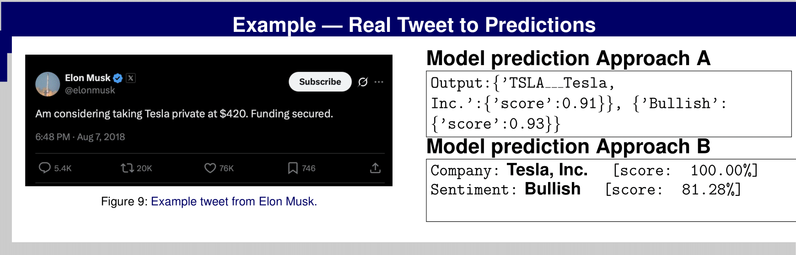
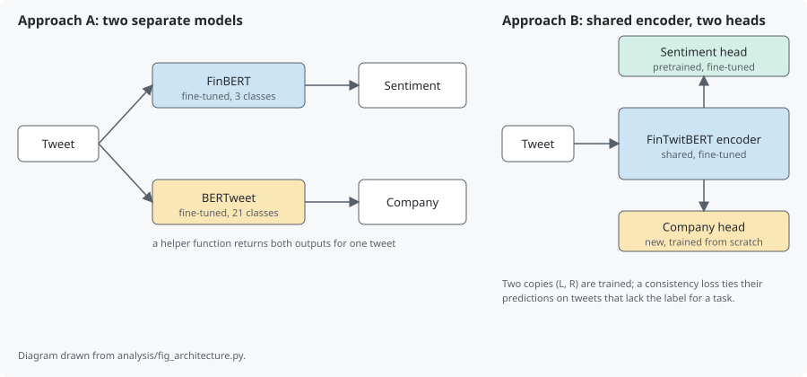
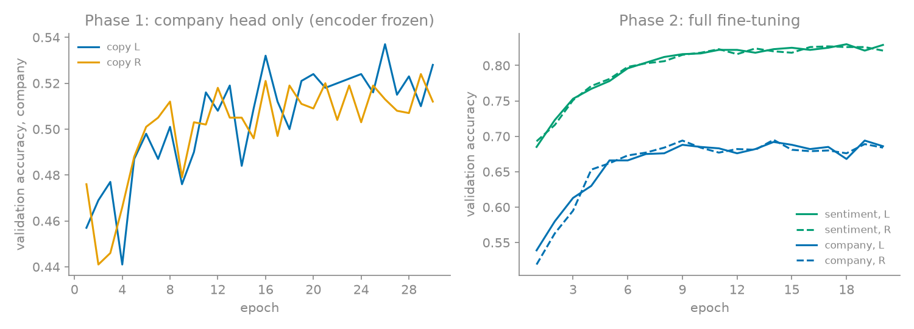
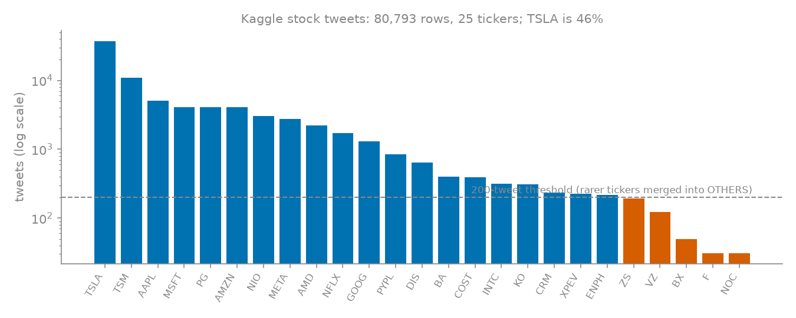
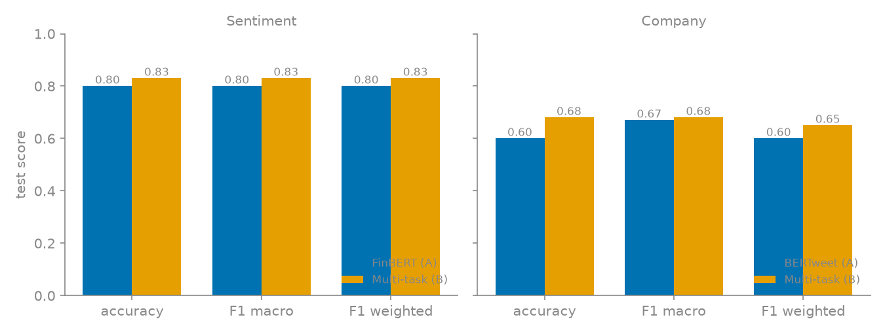

> What is this project about? Teaching one language model to read a tweet about a listed company and say both how the author feels about the stock and which company it is about, even though no dataset has both labels. We compared two fine-tuned models against one shared-encoder multi-task model. A two-person SSY340 course project (Chalmers).

# Financial tweet classification: sentiment and company in one model

## TLDR



*The model in use: one tweet in, a company and a sentiment out. Clipped from the project poster; Approach B's output is also reproduced in `notebooks/ApproachB.ipynb`.*

**Problem.** A tweet about a listed company carries two things we want: how the author feels about the stock (bearish, neutral, bullish) and which company it is about. No public dataset has both labels. One has sentiment only, the other has company only.

**Approach.** We tried two designs on the same preprocessed data. Approach A fine-tunes two pretrained models, FinBERT for sentiment and BERTweet for company. Approach B puts one FinTwitBERT encoder under two heads and trains it on both datasets at once, with a consistency loss that stands in for the missing labels.

**Results.** On the held-out test set the multi-task model reaches 0.835 accuracy on sentiment and 0.680 on company (21 classes). The two-model baseline scored 0.80 and 0.60 in the course report. The gain is small and comes from a single run per model. Training and test numbers are in [docs/results.md](docs/results.md).

## Repo map

```
README.md
notebooks/   the two course notebooks (Approach A, Approach B) with their saved outputs
src/         tweet normaliser and the 21-class company mapping
analysis/    scripts that regenerate every figure and the metrics JSON
docs/        method notes, results and data sources, metrics/*.json
media/       figures, diagram and the poster clipping used here
Makefile     `make figures`
```

## Problems we had to solve

1. **Disjoint labels.** Each dataset has one label per tweet, never both, so a joint model has no tweet with two ground-truth labels.
2. **Class imbalance.** Tesla is 46% of the company data and 5 of 25 tickers have under 200 tweets. Sentiment is roughly 44/30/26.
3. **Noisy tweet text.** Mentions, links, hashtags and emoji vary a lot and carry little of the signal.
4. **A new head on a pretrained encoder.** The company head starts random while the sentiment head is already good. Training both together at once pulls the encoder around before the new head is useful.
5. **Comparing the designs fairly.** Both approaches need the same cleaning, balancing and label maps so the comparison is about the architecture.

## Approach we took

Both approaches share one data pipeline. Tweets are normalised (mentions to `@USER`, links to `HTTPURL`, emoji to text). Each dataset is balanced by sampling equal rows per class, and tickers under 200 rows are merged into `OTHERS`, leaving 21 company classes.



**Approach A (brief).** FinBERT and BERTweet are fine-tuned separately with the Hugging Face `Trainer`, early stopping on macro F1, and a helper that runs both on one tweet.

**Approach B (in depth).**

- *Model.* FinTwitBERT is the shared encoder. Its original head handles sentiment. A new head (768, 1024, 21 with ReLU and dropout) handles company and is initialised from scratch.
- *Merged data.* The two datasets are concatenated. Every row has one real label and the other label is set to an ignore value, so the cross entropy skips it.
- *Two copies and a consistency loss.* Two copies of the network, L and R, are trained together. Where a tweet has a label for a task, both copies learn from it. Where it does not, a KL term pushes the two copies to agree. The loss is `L_GT + lambda * L_semi` with lambda 1, after the Knowledge Assembly method.
- *Two phases.* Phase 1 freezes the encoder and sentiment head and trains only the company head (lr 5e-3, 30 epochs, class-weighted loss). Phase 2 unfreezes everything (heads 1e-4, encoder 1e-5, 20 epochs).
- *Model selection.* The checkpoint that scores best on validation is kept for inference. The notebook also holds a `load_model_and_predict` function that returns a sentiment label and a company name with probabilities for any tweet.

## Our solutions

**Problem 1, disjoint labels.** The two-copy consistency loss lets one network learn from both datasets. Both tasks improve together over phase 2, and the L and R copies track each other closely.



**Problem 2, class imbalance.** The raw company data is dominated by one ticker, so balanced sampling and the `OTHERS` class were needed. The company task is still the weaker one, at 0.68 accuracy over 21 classes.



**Problem 3, noisy text.** The shared normaliser in `src/` is applied before any tokenizer. We did not run an ablation without it, so we cannot say how much it helped.

**Problem 4, the new head.** The two-phase schedule trains the company head first. Phase 1 alone reaches about 0.52 company accuracy. Phase 2 lifts it to about 0.68 while sentiment holds near 0.83.

**Problem 5, fair comparison.** Same cleaning, same label maps, same metrics for both approaches. The numbers below are test scores. Approach A's come from the course report, Approach B's from the notebook output.



| | Sentiment accuracy | Company accuracy |
|---|---|---|
| Approach A (FinBERT, BERTweet) | 0.80 | 0.60 |
| Approach B (multi-task) | 0.835 | 0.680 |

The multi-task model is ahead on both tasks, by about 3 points on sentiment and 8 on company. We trained each model once, so we cannot separate that from run-to-run noise. We did not build a full Knowledge Assembly pipeline beyond what the notebook contains, and we did not try named entity recognition to find the company.

## How to run

```bash
python -m venv .venv && . .venv/bin/activate
pip install -r requirements.txt && make figures
```

This rebuilds every figure from the saved notebook outputs and `docs/metrics/*.json`. It does not retrain anything.

- The notebooks need a GPU, network access for the Hugging Face datasets and checkpoints, and the Kaggle CSV ([Stock Tweets for Sentiment Analysis and Prediction](https://www.kaggle.com/datasets/equinxx/stock-tweets-for-sentiment-analysis-and-prediction)) at `dataset/stock_tweets.csv`. The sentiment data is [StephanAkkerman/financial-tweets](https://huggingface.co/datasets/StephanAkkerman/financial-tweets). Neither dataset is in this repo. `make counts` recounts classes if you place the CSV at `data/stock_tweets.csv`.
- Approach A has no saved outputs, so its scores come from the report only.
- Known mismatches with the report (a mixed accuracy/F1 figure for BERTweet, the Kaggle row count) are listed in [docs/results.md](docs/results.md).

## License

None set.
